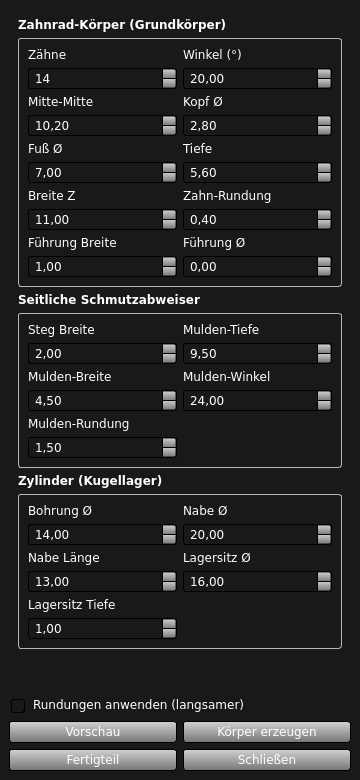

# FreeCAD panel

[← Overview](../../README.md) · [All pages](../../README.md#documentation)

---

1. Copy the project folder into your FreeCAD macro directory (or any location of your choice).
2. Run `freecad/main.py` as a macro in FreeCAD. The **"Zahnrad Setup"** (Gear Setup) panel will automatically dock on the right side.
   On Linux (FreeCAD as Flatpak) a double-click on `linux/freecad-starter/Ritzel-Generator.desktop` does the same.

| Button | Function |
|---|---|
| **Vorschau** (Preview) | Redraws only the sketch of the tooth profile (extremely fast). |
| **Körper erzeugen** (Create Body) | Builds the complete PartDesign solid body. |
| **Fertigteil** (Finished Part) | Creates a clean copy (`RitzelFertig`) without the feature tree – perfect for STL/STEP export. |

**Choosing the part:** At the top of the panel the **Bauteil** (part) selector offers three entries: **Ritzel** (sprocket), **Spannrolle** (idler roller) and **Riemenschutz-Bügel** (belt guard). Each part has its own fields and buttons.

**Belt guard:** When you select it, the panel takes tooth count, centre distance and tip Ø over from the sprocket so the guard fits. You can still change the values afterwards. **Riemenschutz-Bügel erzeugen** builds it to match the active workbench: as a finished solid in **Part**, as a body with history in **Part Design** (other workbenches behave like Part Design). The guard exists for **12–18 teeth** only.

**Tip:** The **"Rundungen anwenden"** (Apply Fillets) checkbox controls the fillets. Since these consume the most performance during calculation, it is best to leave them unchecked for quick drafts. Enable them only for the final part export.

**Prerequisites:** FreeCAD 1.1+ (tested as Flatpak on Linux), no additional dependencies. The panel UI is in German.

